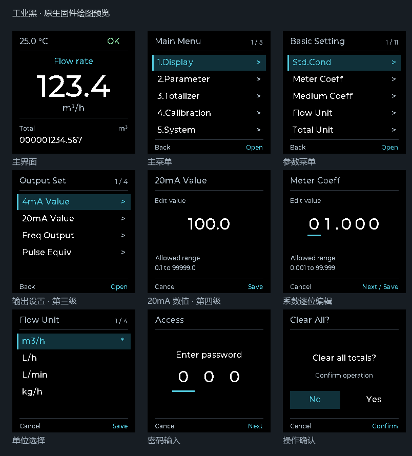

# 工业黑界面实现

本分支把已确认的 LVGL（Light and Versatile Graphics Library，轻量图形库）电脑预览转成现有 ST7789 绘图接口调用。MCU 固件继续使用自己的显示驱动；页面数据、密码校验和保存流程沿用原实现。

## 修改前后

| 部分 | 修改前 | 本次实现 |
|---|---|---|
| 字体 | 6×8、7×10 点阵放大，另有 24×32 数字和标题字模 | Montserrat Medium 原生 1bpp 字模，12/16px 文本、32/60px 数字 |
| 主界面 | 左侧 FLOW/TOTAL 标题、较小数值 | 顶部温度/状态，中部大流量，底部完整累积量 |
| 列表/枚举 | 六行，蓝底黄字选中 | 固定五项分页，深青底、青色左边条、灰色页脚和位置计数 |
| 数值/密码 | 彩色数字块 | 白色数字、青色下划线，保留逐位编辑行为 |
| 刷新定位 | 大数字按固定字宽计算 | 按每个字符的实际宽度累加，字符槽变化时清除整个数值区域 |

1bpp 是每个像素占一位，只表示字形/背景，绘制时再填入 RGB565 颜色（红 5 位、绿 6 位、蓝 5 位）。它比电脑稿的抗锯齿字模小，细字边缘需以实屏观察为准。

以下是生产 C 绘图函数的离线像素输出，数据为测试输入：



核心刷新规则位于 `BSP/run_display.c`：字符宽度和位置都不变时，只更新变化的字符；宽度或居中位置改变时重绘流量区域，避免新旧字符叠在一起。

```c
if (OLED_TextWidth(glyph, font) != OLED_TextWidth(old_glyph, font))
    same_cells = 0U;
```

`BSP/display.c` 通过字形的 `advance`（字符前进宽度）统一计算绘制位置与文本宽度。`BSP/bsp_menu.c` 仅修改 ST7789 公共绘图模板，按键处理函数和单色屏模板未改动。确认页左侧为 No、右侧为 Yes，内部仍然用 `confirm_sel == 0` 表示 No。

列表和枚举共用 `menu_page_start`，按零起点索引计算固定页首：

```c
return (uint8_t)((selected / LCD_MENU_ROWS) * LCD_MENU_ROWS);
```

因此选中第 1～5 项时显示 1～5，第 6～10 项时显示 6～10，第 11 项时只显示 11。同页只更新旧、新选中行和顶部计数；跨页只清空并重绘列表区域，标题和页脚保持不变。向下跨页选中首行，向上跨页选中上一页末行；不足五项的末页留空，避免旧条目残留。

## 字模再生成

生成器依赖 Python 和 Pillow。传入 Montserrat Medium 原始 TTF（TrueType Font，矢量字体）文件；生成头文件记录源文件 SHA-256 校验值，授权见 `OLED/licenses/industrial-OFL.txt`。正常固件构建直接使用已提交头文件，不需要 Python 或 TTF。

```text
python scripts/generate_industrial_fonts.py "D:/NXP/GUI-Guider-1.10.1-GA/environment/fonts/montserratMedium.ttf"
```

字形按行连续存位，不在每一行补齐到整字节；去掉上下空白，保留字符宽度、顶部空白与有效高度。生成时补偿 `j` 等字符的负左边界，避免切掉笔画。四档字模及度量共 5,759B，另有描述结构与链接对齐开销。彩屏构建关闭旧 SSD1306 字体；单色屏构建继续启用原字体。

## 软件验证

测试用 GCC（GNU Compiler Collection，GNU 编译器集合）编译真实 `display.c`、`run_display.c`、`ftoa.c` 和从 `bsp_menu.c` 提取的原样绘图函数。替换屏幕总线和参数输入，不引入测试专用生产接口。

```text
python -m unittest discover -s tests -v
```

- 12 项测试通过，四档全部字符与独立 TTF 栅格图逐像素相同。
- 主界面覆盖流量进位、长度/小数位置变化、立方米和其他单位、完整累积量；数据不变时主/辅助页零写屏。
- 42 个菜单页可完整渲染；120 次局部更新与全屏重绘逐像素一致，覆盖列表/枚举双向滚动、系数光标、密码错误出现/消失、确认项切换及数值正负变化。
- 新增固定五项分页检查，记录每次移动的实际选中行、列表清空次数、整屏刷新次数和像素写入量；同页不清空列表，跨页清空一次，选择移动不触发整屏刷新，并检查 11 项列表及两个 6 项枚举的末页空白。
- 检查文字完整边界、屏幕地址和最终写入均未越界。
- IAR 9.60.4 彩屏/单色屏：0 错误、0 警告，最终配置恢复为彩屏。
- STM32CubeIDE Release 彩屏：构建通过，无编译警告。

IAR 最终链接结果：只读代码 41,729B、只读数据 8,821B；从应用起点到最后一个 Flash 装载段的跨度为 50,568B（含 18B 空隙），52KiB 应用区剩余 2,680B。相比分支起点增加 556B，RAM 仍为 9,230B，8 行 RGB565 缓冲仍为 3,840B。

这些结果只证明离线绘图与构建。尚未连接或烧录硬件，实屏可读性、软件串行总线耗时、闪烁和通信联动仍需目标板验证。现有 `ftoa` 超过 99,999 显示 `----` 的规则和设备信息页原有版本文本仍沿用，未在本次视觉替换中调整。
