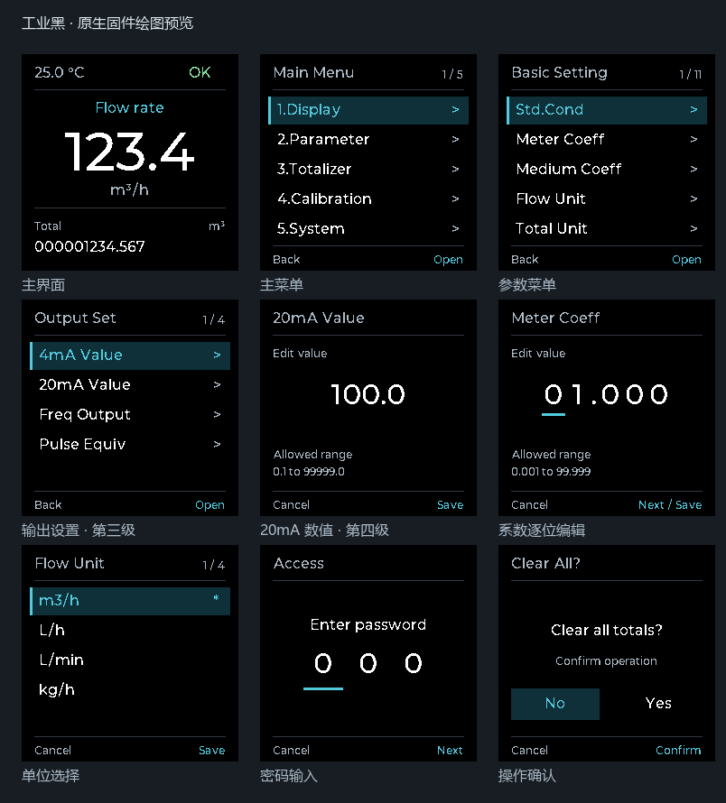

# 工业黑界面实现

本分支把已确认的 LVGL（Light and Versatile Graphics Library，轻量图形库）电脑预览转成现有 ST7789 绘图接口调用。MCU 固件继续使用自己的显示驱动；页面数据、密码校验和保存流程沿用原实现。

## 修改前后

| 部分 | 修改前 | 本次实现 |
|---|---|---|
| 字体 | 6×8、7×10 点阵放大，另有 24×32 数字和标题字模 | Montserrat Medium 原生 1bpp 字模，12/16px 文本、32/60px 数字 |
| 主界面 | 左侧 FLOW/TOTAL 标题、较小数值 | 顶部温度/状态，中部大流量，底部完整累积量 |
| 列表/枚举 | 六行，蓝底黄字选中 | 固定五项分页，深青底、青色左边条、灰色页脚和位置计数 |
| 数值/密码 | 彩色数字块 | 白色数字、青色下划线，保留逐位编辑行为 |
| 刷新定位 | 大数字按固定字宽计算 | Flow/Total 按新旧字形和实际坐标比较，只写颜色变化的像素 |

1bpp 是每个像素占一位，只表示字形/背景，绘制时再填入 RGB565 颜色（红 5 位、绿 6 位、蓝 5 位）。它比电脑稿的抗锯齿字模小，细字边缘需以实屏观察为准。

以下是生产 C 绘图函数的离线像素输出，数据为测试输入：



核心刷新规则位于 `BSP/run_display.c` 和 `BSP/display.c`：Flow/Total 日常更新不再先清空数值矩形。按旧坐标还原旧字形、按新坐标还原新字形，逐行比较像素颜色，只发送本行连续变化的像素。数字长度、字宽或居中位置变化时也使用相同路径，消失的旧笔画直接写成背景色。主页面和辅助页均采用此规则，首次进入或整页失效仍完整合成页面。

```c
if (old_pixels[col] == new_pixels[col]) {
    col++;
    continue;
}
```

`BSP/display.c` 通过字形的 `advance`（字符前进宽度）统一计算绘制位置与文本宽度。`BSP/bsp_menu.c` 仅修改 ST7789 公共绘图模板，按键处理函数和单色屏模板未改动。确认页左侧为 No、右侧为 Yes，内部仍然用 `confirm_sel == 0` 表示 No。

差异比较复用原 8 行 RGB565 缓冲中的两行，不新增整屏缓存。底层地址窗口仍是矩形，但每次仅覆盖一行中连续变化的像素，不包含未变化的字符或背景；新旧字体和前景/背景色必须相同。

列表和枚举共用 `menu_page_start`，按零起点索引计算固定页首：

```c
return (uint8_t)((selected / LCD_MENU_ROWS) * LCD_MENU_ROWS);
```

因此选中第 1～5 项时显示 1～5，第 6～10 项时显示 6～10，第 11 项时只显示 11。同页只更新旧、新选中行和顶部计数；跨页只清空并重绘列表区域，标题和页脚保持不变。向下跨页选中首行，向上跨页选中上一页末行；不足五项的末页留空，避免旧条目残留。

## 超量程提示（2026-11-02）

主界面流量超过 2.4 m³/h 时隐藏数字，显示 `Over range`，低于 2.0 m³/h 才恢复数字。2.0～2.4 m³/h（含端点）保持先前状态。这种进入和退出使用不同阈值的方式称为滞回，可避免流量在边界附近波动时反复切换。

`Core/Src/main.c` 将同一次获取的有效流量分为两路：显示数值经 `limit_flow_rate()` 限制在 2400 L/h 后再换算单位，报警输入保留未限幅值。`BSP/run_display.c` 用 2400 L/h、2000 L/h 判断报警状态，不使用经过格式化的小数文本，因此单位、介质密度和显示舍入不会改变阈值。状态在每次显示更新时判断一次，整页分段渲染不会重复推进状态；切页或屏幕重绘保留状态，显示模块初始化时清除。

彩屏提示复用 `OLED_FONT_MEDIUM`（Flow rate 标题的 16px 字模），在原数字区域居中；仅数字与提示互换时清除该区域，正常数字更新继续使用像素差异刷新。单色屏使用现有文字字模。辅助实时数据页保持数值显示，报警状态仍随流量更新，返回主界面时显示当前状态。

辅助页流量、Modbus 40001~40002 回包和自动电流计算的流量输入都限制在 2400 L/h；数值降至 2400 以下立即按实际值处理，警告仍需低于 2000 才解除。例如实际流量从 2600 降至 2300 L/h 时，辅助页和 Modbus 返回 2300，主界面仍显示 `Over range`。Modbus 保留原来未滤波的传感器数据来源，只对回包快照限幅，不改写原始数据；显示和自动电流使用滤波后的有效流量。自动电流在仪表/介质系数和七点标定之前限幅，后续换算和输出上下限沿用原逻辑。累积量保持传感器原有路径。

离线新增 60 组画面检查：四种流量单位各 14 组，覆盖两个阈值上下及相等、报警保持与恢复；另外 4 组检查切页和初始化。每组检查局部更新与完整重绘逐像素一致、重复输入零写屏；报警画面与现有标题字体绘制的参考提示完全一致。显示测试共 15 项，14 项通过，原有第 45 号菜单页缺失的用例仍失败；本次未修改菜单代码或放宽对应断言。

限幅新增 5 项目标指令测试：边界和即时恢复、传感器/滤波数据保留、四种显示单位及未限幅报警输入、Modbus 流量限幅与温度/压力字段不受影响、自动电流在系数修正前限幅。正常回归组 34 项全部通过，报告位于 `tests/firmware/build/flow-limit-regression/report.json`；运行器异常自检两项通过，原有 60 组超量程画面检查仍通过。

IAR 彩屏全量构建、单色屏构建均为 0 错误、0 警告，最终恢复为彩屏配置；STM32CubeIDE Release 彩屏构建通过且无编译警告。尚未烧录或进行目标板显示验收。

## 字模再生成

生成器依赖 Python 和 Pillow。传入 Montserrat Medium 原始 TTF（TrueType Font，矢量字体）文件；生成头文件记录源文件 SHA-256 校验值，授权见 `OLED/licenses/industrial-OFL.txt`。正常固件构建直接使用已提交头文件，不需要 Python 或 TTF。

```text
python scripts/generate_industrial_fonts.py "D:/NXP/GUI-Guider-1.10.1-GA/environment/fonts/montserratMedium.ttf"
```

字形按行连续存位，不在每一行补齐到整字节；去掉上下空白，保留字符宽度、顶部空白与有效高度。生成时补偿 `j` 等字符的负左边界，避免切掉笔画。四档字模及度量共 5,759B，另有描述结构与链接对齐开销。彩屏构建关闭旧 SSD1306 字体；单色屏构建继续启用原字体。

## 像素差异修复验证（2026-10-30）

- 新增 40 组主/辅助页 Flow、Total 更新，覆盖单数字变化、进位、字宽/长度变化、居中移动、超量程占位符和重复值。每组同时检查：最终画面与完整重绘一致、实际写入数等于新旧画面的变化像素数、重复值零写屏。
- 修复前 Flow 从 `0.000` 到 `0.008` 写入 25,408 个像素，含 20,555 次相同颜色写入；修复后仅写 371 个实际变化像素。Total 从 `000001234.567` 到 `000001234.568` 仅写 53 个实际变化像素。
- IAR 9.60.4 和 STM32CubeIDE Release 彩屏构建均通过，0 错误、0 警告。升级包均为 53,248B；IAR Flash 装载跨度 51,028B、应用区剩余 2,220B，RAM 分配 9,234B；CubeIDE Flash 装载跨度 49,480B、剩余 3,768B。
- 全量主机测试运行 19 项，15 项通过，以下 4 项失败；本次未修改对应的菜单/串口生产代码，也未放宽原断言：
  - `test_all_43_menu_pages_have_header_and_footer`：当前菜单枚举仅到 44，缺少测试要求的第 45 号页面文件。
  - `test_menu_confirm_cancel_limits_and_factory_reset`：进入旋转菜单时无法得到第 45 号枚举页面。
  - `test_back_to_back_frames_keep_receiving_without_overwriting_pending_frame`：`u.receiving == 1` 断言失败。
  - `test_idle_reception_does_not_abort_transmission`：`u.sending == 1` 断言失败。
- 以上为离线绘图与构建验证，尚未烧录；屏幕总线时序、实屏闪烁和通信联动仍需目标板验证。

## 工业黑界面初始验证（2026-10-27）

测试用 GCC（GNU Compiler Collection，GNU 编译器集合）编译真实 `display.c`、`run_display.c`、`ftoa.c` 和从 `bsp_menu.c` 提取的原样绘图函数。替换屏幕总线和参数输入，不引入测试专用生产接口。

```text
python -m unittest discover -s tests -v
```

- 12 项测试通过，四档全部字符与独立 TTF 栅格图逐像素相同。
- 主界面覆盖流量进位、长度/小数位置变化、立方米和其他单位、完整累积量；数据不变时主/辅助页零写屏。
- 42 个菜单页可完整渲染；120 次局部更新与全屏重绘逐像素一致，覆盖列表/枚举双向滚动、系数光标、密码错误出现/消失、确认项切换及数值正负变化。
- 新增固定五项分页检查，记录每次移动的实际选中行、列表清空次数、整屏刷新次数和像素写入量；同页不清空列表，跨页清空一次，选择移动不触发整屏刷新，并检查 11 项列表及两个 6 项枚举的末页空白。
- 检查文字完整边界、屏幕地址和最终写入均未越界。
- IAR 9.60.4 彩屏/单色屏：0 错误、0 警告，最终配置恢复为彩屏。
- STM32CubeIDE Release 彩屏：构建通过，无编译警告。

IAR 最终链接结果：只读代码 41,729B、只读数据 8,821B；从应用起点到最后一个 Flash 装载段的跨度为 50,568B（含 18B 空隙），52KiB 应用区剩余 2,680B。相比分支起点增加 556B，RAM 仍为 9,230B，8 行 RGB565 缓冲仍为 3,840B。

这些结果只证明离线绘图与构建。尚未连接或烧录硬件，实屏可读性、软件串行总线耗时、闪烁和通信联动仍需目标板验证。现有 `ftoa` 超过 99,999 显示 `----` 的规则和设备信息页原有版本文本仍沿用，未在本次视觉替换中调整。
