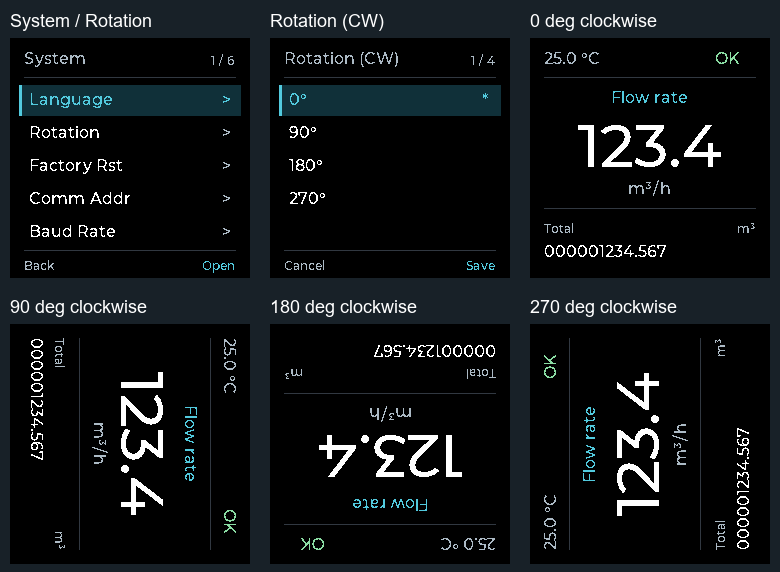

# ST7789 屏幕旋转

2026-10-29，分支 `codex/st7789-screen-rotation`，以工业黑界面分支为基础，未发布。

## 操作

1. 按 K2 进入菜单，沿用已有密码验证，进入 `5.System → Rotation`。
2. 按 K1（向下）或 K3（向上）选择 0°、90°、180°、270°，均相对原显示方向顺时针旋转。
3. 按 K2 确认，保存后立即旋转并返回系统菜单；K1+K2 返回取消。重启保留设置，恢复出厂设置回到 0°。

菜单标题 `Rotation (CW)` 中 CW 是 Clockwise（顺时针）。此设置仅在 ST7789 彩屏固件显示。系统菜单现在有六项，沿用固定五项分页；原按键的物理定义不随显示角度改变。



菜单图来自真实生产 C 绘图函数的离线像素输出；四方向示意由同一运行页按角度变换得到，并非实屏照片。方向寄存器与地址偏移由独立的总线命令测试核对。

## 核心修改

原来 `USE_HORIZONTAL` 是编译期固定值；初始化和定时自愈都把显示方向设成 0°。现在 `LCD_SetRotation()` 保存运行时角度索引，初始化、菜单保存、出厂复位和自愈共用该路径。

ST7789 的 MADCTL（Memory Data Access Control，显存访问控制）寄存器决定行列交换与方向。以原来的 0° 为基准，索引按顺时针排列：

```c
static const u8 madctl[4] = { 0x00, 0x60, 0xC0, 0xA0 };
```

240×240 面板只使用 240×320 显存的一部分，因此地址窗口也要随角度变化。180° 时 Y 地址加 80，270° 时 X 地址加 80；0°/90°不加偏移。只改方向寄存器而不改窗口会造成错位或裁切。四角映射依据 [Adafruit ST7789 驱动的 setRotation() 实现](https://github.com/adafruit/Adafruit-ST7735-Library/blob/master/Adafruit_ST7789.cpp)，以其 MADCTL=0 的方向作为本项目 0°；RGB 颜色顺序保持原值。

`param_storage` 在参数页偏移 0x09E 的原保留字节保存索引 0～3，仍在现有 CRC（Cyclic Redundancy Check，循环冗余校验）范围内；没有移动原字段或 Bootloader 通信槽。旧页此处为 0xFF，或读取到其他非法值时，使用 0°。菜单按原保存流程调用 `param_flush()`；取消只丢弃菜单临时值，不写 Flash，也不改变硬件方向。

## 验证与边界

- 16 项离线测试通过：43 个菜单页、128 次局部刷新，四个角度的方向/地址命令，菜单确认/取消/限位/出厂复位，参数保存/重读、旧页兼容及启动/自愈恢复。
- IAR 9.60.4 彩屏/单色屏均为 0 错误、0 警告，最终配置恢复彩屏；STM32CubeIDE Release 彩屏构建通过且无编译警告。
- IAR 彩屏 Flash 装载跨度 50,860B，相对本功能起点增加 292B，52KiB 应用区剩余 2,388B。只读代码 41,917B，只读数据 8,925B，RAM 分配 9,235B，相对起点增加 5B；原 3,840B 分段像素缓冲不变。

尚未烧录或连接目标板。上板后依次检查四个角度下的主页面、辅助页和菜单，确认边缘完整、旋转方向正确；保存后断电重启，再等待一次自愈周期，检查角度保持；最后检查恢复出厂设置回到 0°。
